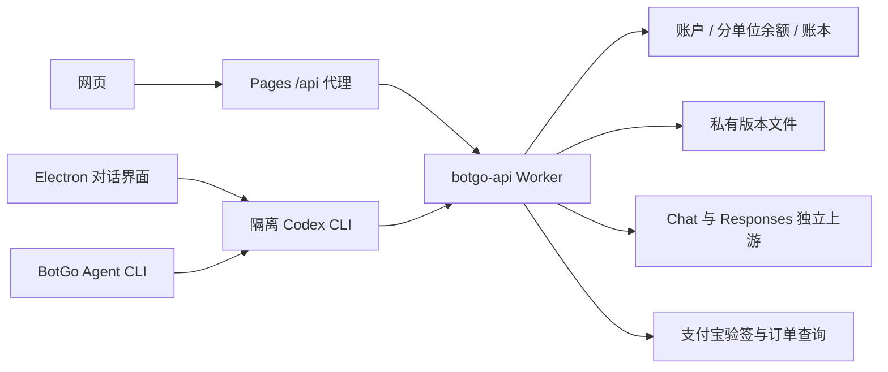

# BotGo 项目地图

先核对工作区状态，再沿任务入口阅读。不要从生成产物反推源码。当前验证状态见 [[notes/Release 2026-09-12]]。

| 任务 | 事实来源与代码入口 | 验收 |
| --- | --- | --- |
| 首页 | `index.html`、`styles.css`、`app.js` | 首页契约与浏览器 |
| 网页工作台与账户面板 | [[notes/UI Workspace]]；`workspace.html/css/js`、`workspace-billing.js` | 响应式、主题、真实对话 |
| Web 云端历史记录 | [[notes/Web History]]；`worker/src/conversations.js`、迁移 0015 | 账户隔离、刷新、流中断、幂等与删除 |
| 登录、支付与扣费 | [[notes/Account and Billing]]；`worker/src/index.js`、`desktop-auth.js`、`alipay-*.js` | 授权、验签、幂等、金额单位 |
| 模型目录与 token 计费 | [[notes/Models and Metering]]；`worker/src/metering.js`、`0014_metered_models.sql`、`admin-metering.js` | 真实用量、原子预留、快照、能力探测 |
| 桌面界面及本地状态 | [[notes/Desktop and CLI]]；`desktop/main.cjs`、`preload.cjs`、`renderer.js/css` | 原生窗口、任务、停止、恢复 |
| CLI 与共用运行器 | [[notes/Desktop and CLI]]；`agent/bin/botgo.cjs`、`agent/lib/` | `npm --prefix agent test` |
| 安装与发布 | `install.ps1`、`agent/scripts/package.ps1`、`DEPLOYMENT.md` | 干净安装、哈希、升级回滚 |
| 后台 | `admin*.js/html/css`、`worker/src/platform-admin.js` | 管理员授权与发布元数据 |
| 预览及构建 | [[notes/Dev Preview]]；`scripts/build.mjs`、`scripts/dev.mjs` | `npm run check` |

后台样式与隔离发布流程：[[notes/Admin UI]]。

## 代码边界

- 网站：原生 HTML/CSS/JS；不在网页中运行本地任务。安装教程允许展示 CLI 安装命令。
- Pages Function：`functions/api/[[path]].js` 经 `BOTGO_API` Service Binding 转发。
- Worker：D1 `botgo`，R2 `botgo-desktop-releases`；资源 ID 以 Wrangler 配置为准。
- 桌面：安全 preload 窄 IPC；设备凭据用 Electron safeStorage。Codex 配置在应用数据目录，旧全局配置备份仍可恢复。
- CLI：Windows Credential Manager 存设备凭据；`%LOCALAPPDATA%/BotGo/Agent/codex` 为隔离配置。
- 共用执行实现位于 `agent/lib/codex-runner.cjs`、`native.cjs`、`codex-config.cjs`；桌面打包复制这份实现及固定 Codex 二进制。
- `dist/`、`desktop/dist/`、`agent/dist/`、`.tmp-*` 为产物；`.secrets/`、工具缓存和本地技能不提交。

## 验证与维护

执行 `npm test`、`npm run check`、`git diff --check`。静态检查不能替代真实登录、扣费、原生安装或视觉验收。

文档使用 Obsidian wikilink；发布记录保存日期、操作、证据和限制，禁止把旧版本的成功描述成当前成功。保留数据库迁移、用户数据和 Git 历史；清理只针对确认冗余且已有承接说明的文件。
